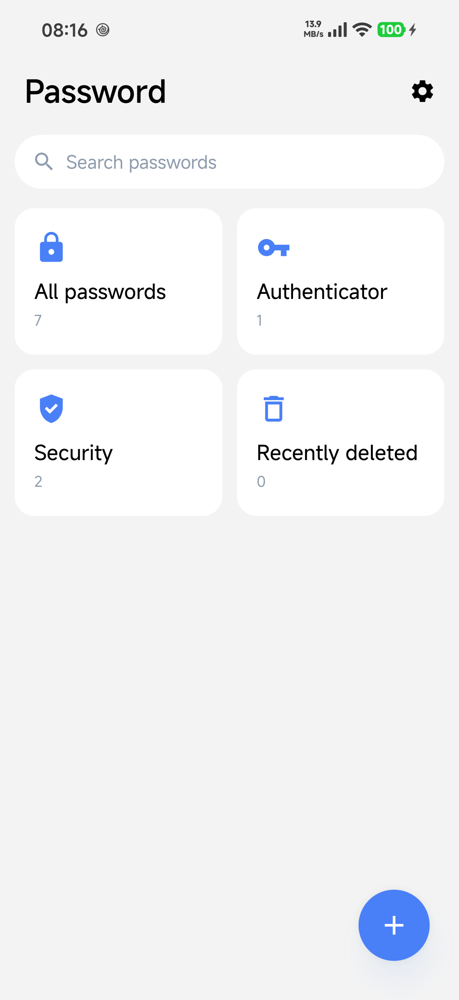
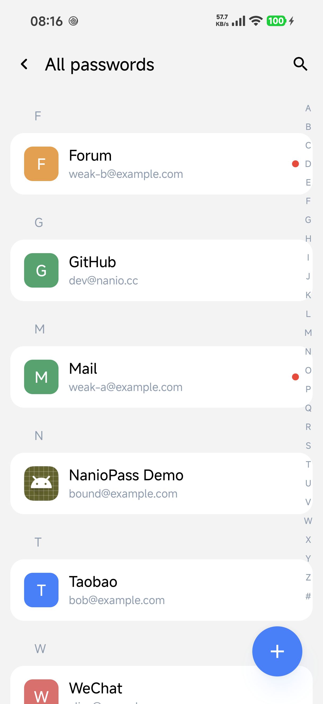
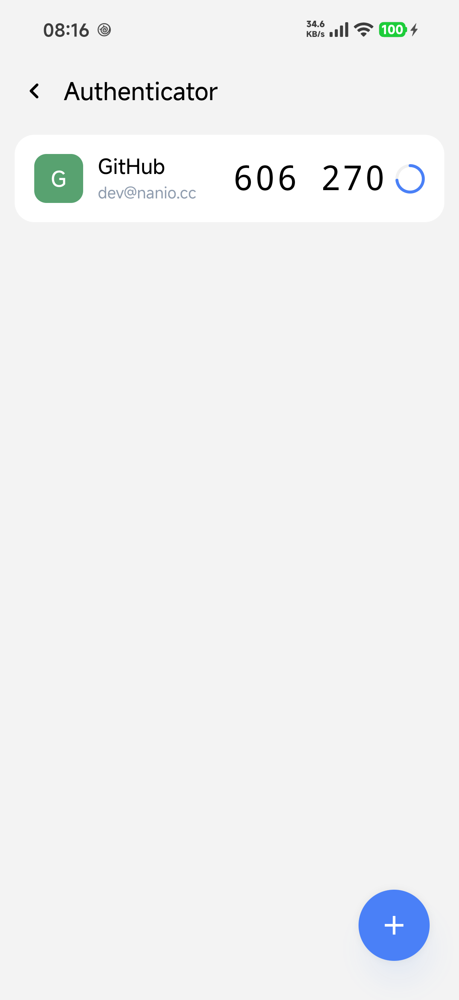
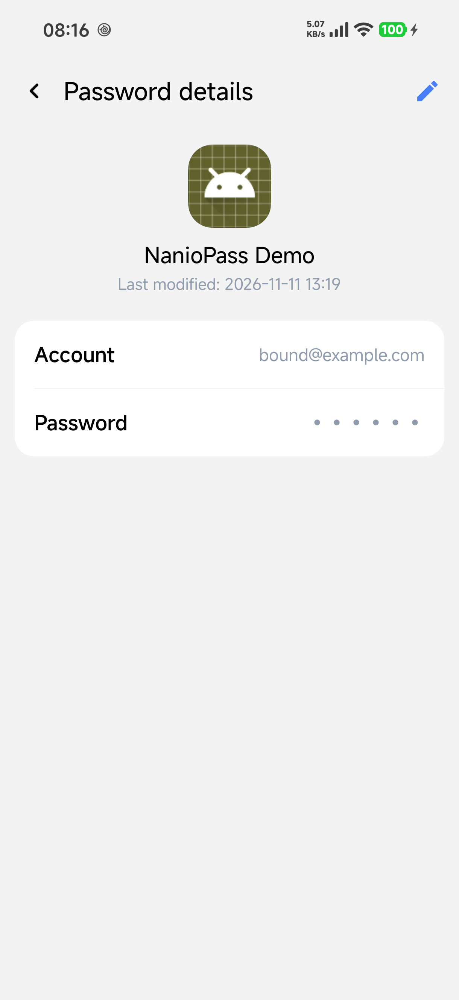
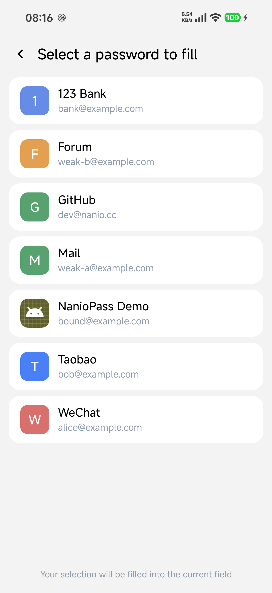
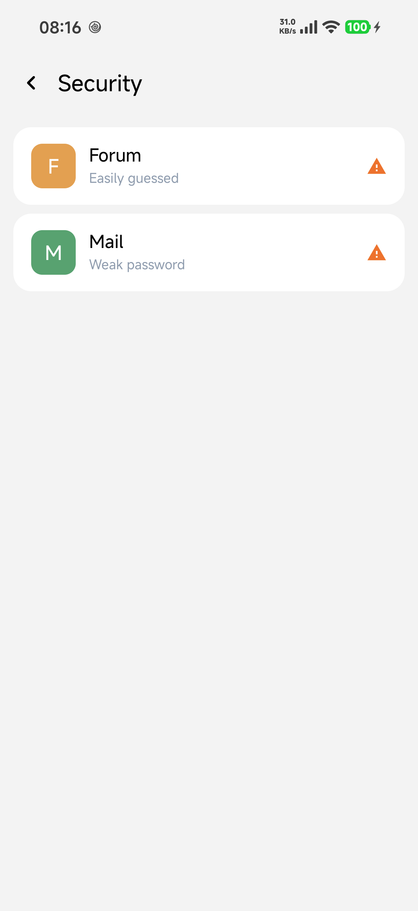
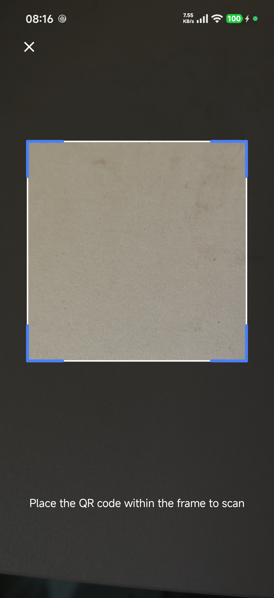

<h1 align="center">NanioPass</h1>

<p align="center">A local-first Android password manager · Passwords / TOTP / Autofill / Credential service</p>

<p align="center">
  <a href="README.md">简体中文</a> · <a href="README.zh-TW.md">繁體中文</a> · <b>English</b>
</p>

<p align="center">
  
  
  
</p>

---

NanioPass is a **fully offline** password manager: no account, no network access, and everything is encrypted and stored only on your device. It supports a password vault, TOTP tokens, autofill, and the Android 14+ credential service, with a Jetpack Compose UI.

## Screenshots

| Home | All passwords | Authenticator | Password details |
|---|---|---|---|
|  |  |  |  |

| Autofill | Security tips | Scan |
|---|---|---|
|  |  |  |

## Highlights

### Password management
- Add / edit / delete (soft delete), pinyin grouping with an A–Z/# index bar, and a dedicated search page
- Bind entries to installed apps; icons and names are read automatically
- Tap to copy and edit inline from the details page, which also shows the last modified time

### Autofill and credentials
- **AutofillService**: matches candidates by bound app / website and fills them in, including "Use another password…" to pick any entry
- Shows the system "Save password" prompt on the first sign-in submission
- **Credential Provider** (Android 14+): the system credential manager can retrieve, create, and update passwords; saving the same account again only updates the password

### TOTP tokens
- RFC 6238: SHA1 / SHA256 / SHA512, 30-second period, 6/8-digit codes
- Add by secret key or QR scan, and link tokens to existing passwords

### Security and privacy
- Field-level encryption with Android Keystore AES-256-GCM (passwords and TOTP secrets)
- Biometric unlock, auto-lock, and recently deleted
- Local security tips (weak password / easy to guess)
- Screenshot protection: blocks system screenshots, screen recording, and recent-task thumbnails (FLAG_SECURE)
- No network permission; data stays on this device

### Data migration
- Encrypted export / import with a passphrase you choose (so your data stays secure)

## Build

Requirements: JDK 17+, Android SDK (compileSdk 37).

```powershell
.\gradlew.bat :app:assembleRelease
# Output: app\build\outputs\apk\release\NanioPass-1.0.0.apk
```

## Test demo

`testapp/` is a small standalone sign-in demo for testing autofill and credential flows. Run the module directly in Android Studio, or build `testapp-debug.apk` and install it.

Before testing, set NanioPass as the default **autofill service** and **credential service** in system settings. Then tap a field on the demo sign-in page to see fill candidates, or use the buttons to test saving a password / creating a credential.

## Signing

- Signing information lives in `keystore.properties` at the project root (already covered by `.gitignore`, so it is never committed).
- The repository ships a template, `keystore.properties.bak`: copy it to `keystore.properties` and fill in your own values:

```properties
# An absolute path is recommended for storeFile; relative paths resolve against the app module
storeFile=path/to/your.jks
storePassword=your-store-password
keyAlias=your-key-alias
keyPassword=your-key-password
```

- Debug and release share the same signing config, so either build can overwrite the other while keeping data.
- If `keystore.properties` is missing, both builds fall back to the system debug signature (local development only).

Unit tests:

```powershell
.\gradlew.bat :app:testDebugUnitTest
```
