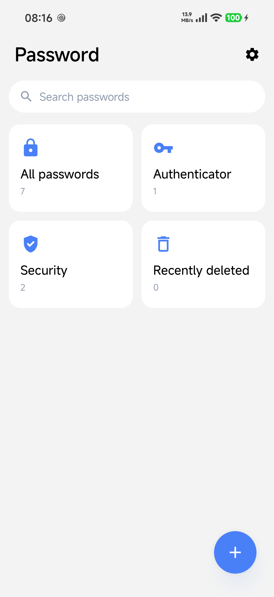
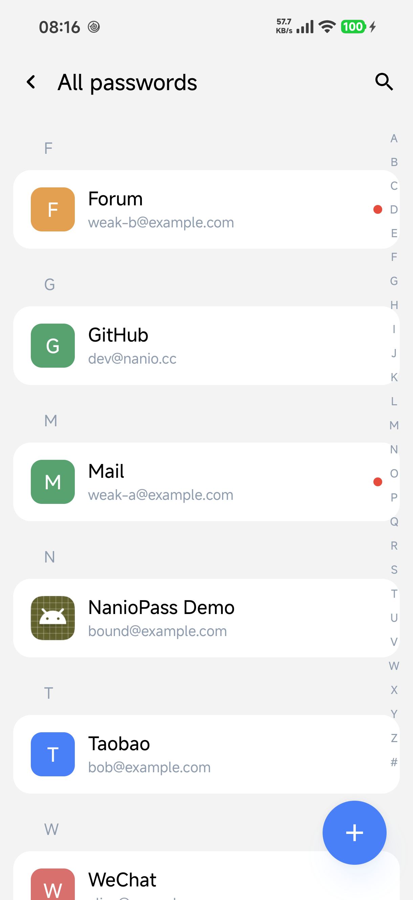
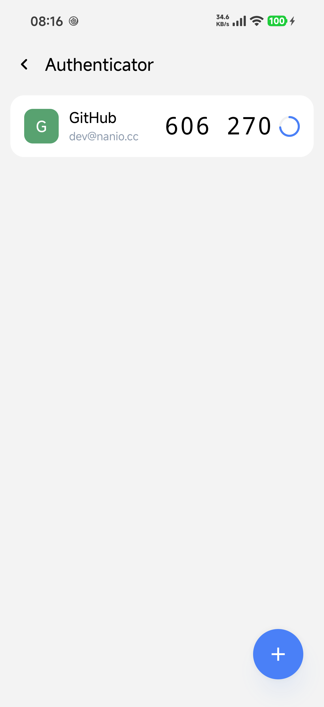
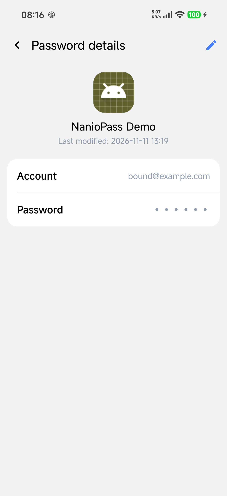
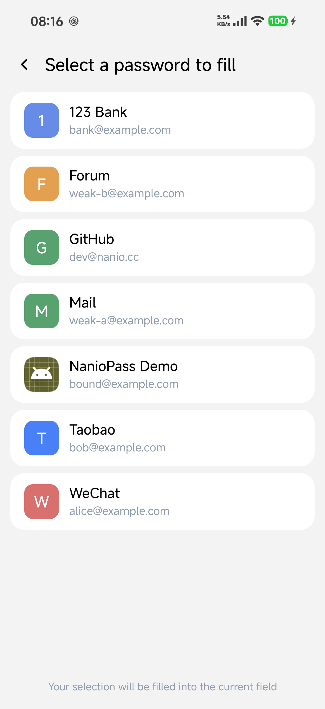
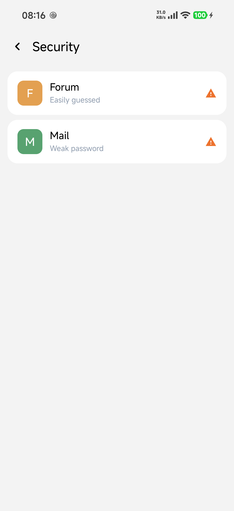
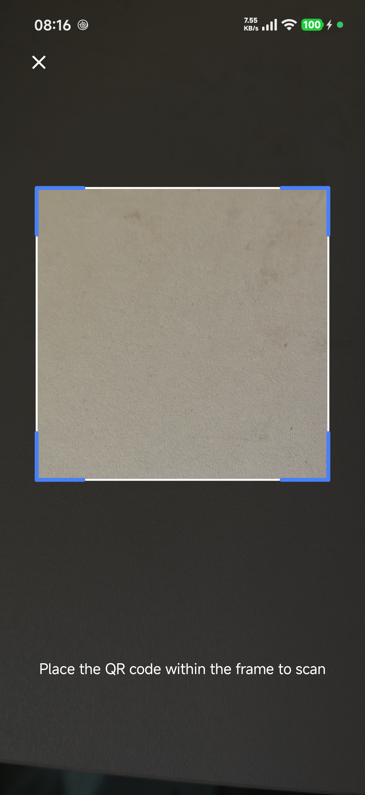

<h1 align="center">NanioPass</h1>

<p align="center">本地优先的 Android 密码管理器 · 密码 / 动态令牌 / 自动填充 / 凭据服务</p>

<p align="center">
  <b>简体中文</b> · <a href="README.zh-TW.md">繁體中文</a> · <a href="README.en.md">English</a>
</p>

<p align="center">
  
  
  
</p>

---

NanioPass 是一款**完全离线**的本地密码管理器：无需账号、不请求网络，数据加密后只保存在本机。支持密码库、动态令牌（TOTP）、自动填充与 Android 14+ 凭据服务，界面使用 Jetpack Compose。

## 截图

| 首页 | 全部密码 | 动态令牌 | 密码详情 |
|---|---|---|---|
|  |  |  |  |

| 自动填充 | 安全性提示 | 扫码 |
|---|---|---|
|  |  |  |

## 核心功能

### 密码管理
- 新增 / 编辑 / 删除（软删除）、拼音分组 + A-Z/# 索引条、独立搜索页
- 可绑定已安装应用，自动读取图标与名称
- 详情页点击复制、行内编辑，并显示上次修改时间

### 自动填充与凭据
- **AutofillService**：按绑定应用 / 网站匹配候选并回填，支持「使用其他密码…」选择任意条目
- 首次登录提交时可弹系统「保存密码」提示
- **Credential Provider**（Android 14+）：系统凭据管理器可获取、创建 / 更新密码，同账号再次保存只更新密码

### 动态令牌（TOTP）
- RFC 6238：SHA1 / SHA256 / SHA512、30 秒周期、6 / 8 位验证码
- 支持手动输入密钥、扫描二维码、关联已有密码

### 安全与隐私
- Android Keystore AES-256-GCM 字段级加密（密码、TOTP 密钥）
- 生物识别解锁、自动锁定、最近删除
- 本地安全性提示（安全强度低 / 容易被猜到）
- 无网络权限，数据仅存本机

### 数据迁移
- 加密口令导出 / 导入（用户自行设置加密口令,保证数据安全）

## 构建

环境：JDK 17+、Android SDK（compileSdk 37）。

```powershell
.\gradlew.bat :app:assembleRelease
# 产物：app\build\outputs\apk\release\NanioPass-1.0.0.apk
```

## 测试 Demo

`testapp/` 是一个独立的小型登录 Demo，用于联调自动填充与凭据流程；可在 Android Studio 中直接运行该模块，或构建 `testapp-debug.apk` 后安装。

使用前请在系统设置中把 NanioPass 设为默认**自动填充服务**与**凭据服务**，然后在 Demo 的登录页点击输入框即可看到填充候选，或使用页面上的按钮测试保存密码 / 凭据创建。

## 签名配置

- 签名信息放在项目根目录 `keystore.properties`（已加入 `.gitignore`，不会入库）。
- 仓库提供模板 `keystore.properties.bak`：复制为 `keystore.properties` 后填写自己的信息：

```properties
# storeFile 建议填绝对路径；相对路径会相对 app 模块目录解析
storeFile=path/to/your.jks
storePassword=你的store密码
keyAlias=你的key别名
keyPassword=你的key密码
```

- debug 与 release 共用同一签名，可互相覆盖安装并保留数据。
- 未提供 `keystore.properties` 时，两种构建都回退到系统默认调试签名（仅供本地开发）。

单元测试：

```powershell
.\gradlew.bat :app:testDebugUnitTest
```
