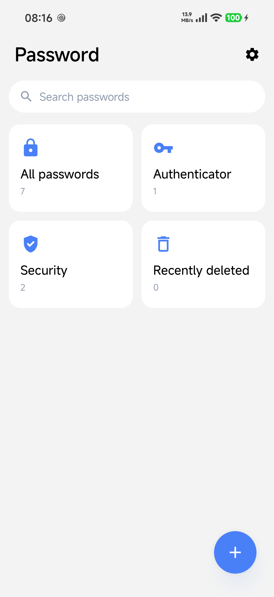
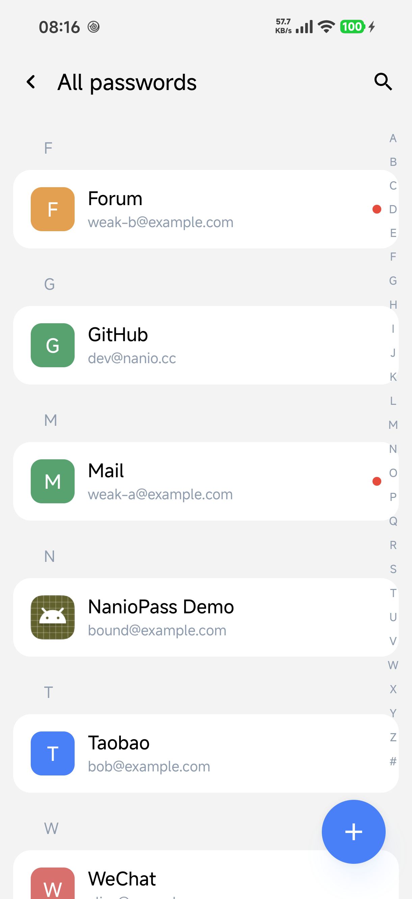
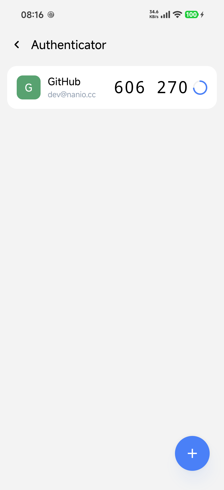
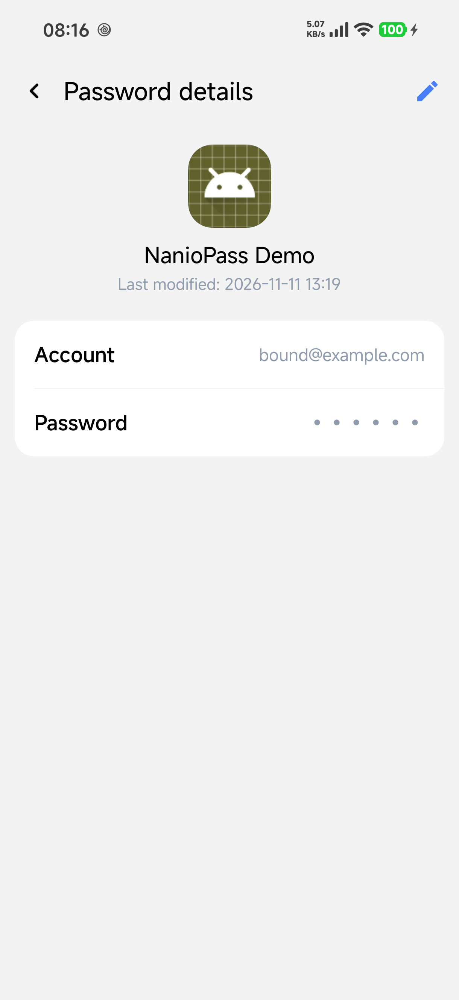
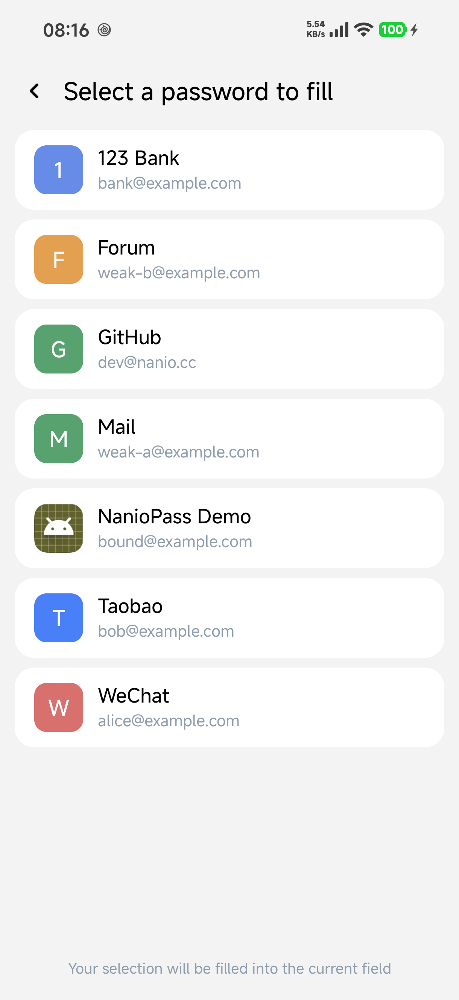
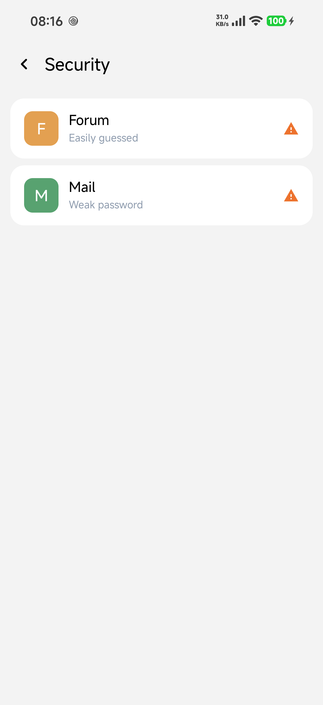
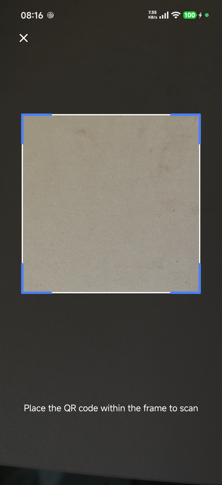

<h1 align="center">NanioPass</h1>

<p align="center">本地優先的 Android 密碼管理器 · 密碼 / 動態令牌 / 自動填充 / 憑證服務</p>

<p align="center">
  <a href="README.md">简体中文</a> · <b>繁體中文</b> · <a href="README.en.md">English</a>
</p>

<p align="center">
  
  
  
</p>

---

NanioPass 是一款**完全離線**的本地密碼管理器：無需帳號、不請求網路，資料加密後只保存在本機。支援密碼庫、動態令牌（TOTP）、自動填充與 Android 14+ 憑證服務，介面使用 Jetpack Compose。

## 截圖

| 首頁 | 全部密碼 | 動態令牌 | 密碼詳情 |
|---|---|---|---|
|  |  |  |  |

| 自動填充 | 安全性提示 | 掃碼 |
|---|---|---|
|  |  |  |

## 核心功能

### 密碼管理
- 新增 / 編輯 / 刪除（軟刪除）、拼音分組 + A-Z/# 索引條、獨立搜尋頁
- 可綁定已安裝應用程式，自動讀取圖示與名稱
- 詳情頁點擊複製、行內編輯，並顯示上次修改時間

### 自動填充與憑證
- **AutofillService**：按綁定應用程式 / 網站匹配候選並回填，支援「使用其他密碼…」選擇任意項目
- 首次登入提交時可彈出系統「儲存密碼」提示
- **Credential Provider**（Android 14+）：系統憑證管理器可取得、建立 / 更新密碼，同帳號再次儲存只更新密碼

### 動態令牌（TOTP）
- RFC 6238：SHA1 / SHA256 / SHA512、30 秒週期、6 / 8 位驗證碼
- 支援手動輸入密鑰、掃描 QR 碼、關聯已有密碼

### 安全與隱私
- Android Keystore AES-256-GCM 欄位級加密（密碼、TOTP 密鑰）
- 生物辨識解鎖、自動鎖定、最近刪除
- 本地安全性提示（安全強度低 / 容易被猜到）
- 無網路權限，資料僅存本機

### 資料移轉
- 以加密口令匯出 / 匯入（由使用者自行設定加密口令，確保資料安全）

## 建置

環境：JDK 17+、Android SDK（compileSdk 37）。

```powershell
.\gradlew.bat :app:assembleRelease
# 產物：app\build\outputs\apk\release\NanioPass-1.0.0.apk
```

## 測試 Demo

`testapp/` 是一個獨立的小型登入 Demo，用於聯調自動填充與憑證流程；可在 Android Studio 中直接執行該模組，或建置 `testapp-debug.apk` 後安裝。

使用前請在系統設定中把 NanioPass 設為預設**自動填充服務**與**憑證服務**，然後在 Demo 的登入頁點擊輸入框即可看到填充候選，或使用頁面上的按鈕測試儲存密碼 / 憑證建立。

## 簽名設定

- 簽名資訊放在專案根目錄 `keystore.properties`（已加入 `.gitignore`，不會入庫）。
- 倉庫提供範本 `keystore.properties.bak`：複製為 `keystore.properties` 後填寫自己的資訊：

```properties
# storeFile 建議填絕對路徑；相對路徑會相對 app 模組目錄解析
storeFile=path/to/your.jks
storePassword=你的store密碼
keyAlias=你的key別名
keyPassword=你的key密碼
```

- debug 與 release 共用同一簽名，可互相覆蓋安裝並保留資料。
- 未提供 `keystore.properties` 時，兩種建置都回退到系統預設偵錯簽名（僅供本地開發）。

單元測試：

```powershell
.\gradlew.bat :app:testDebugUnitTest
```
